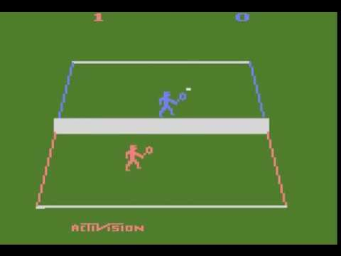
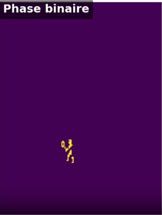
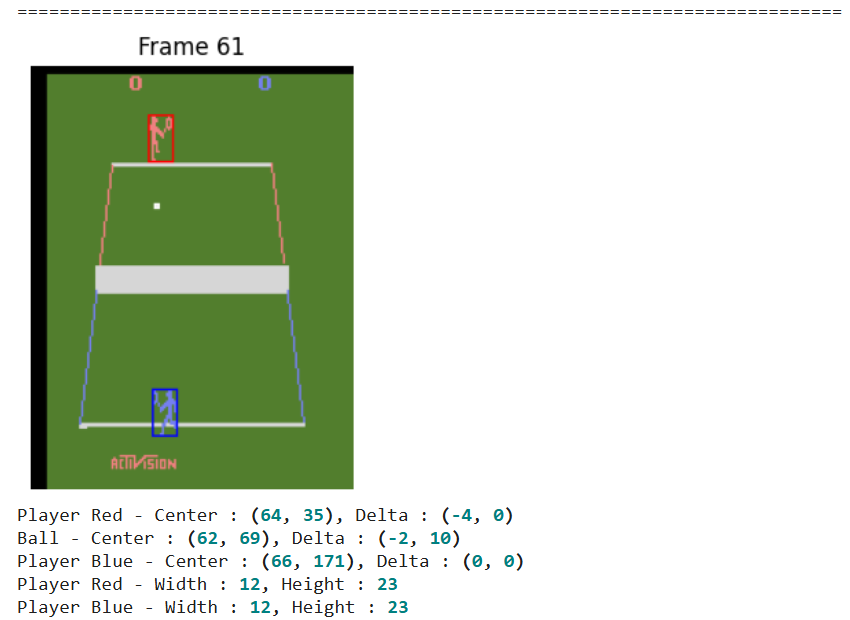
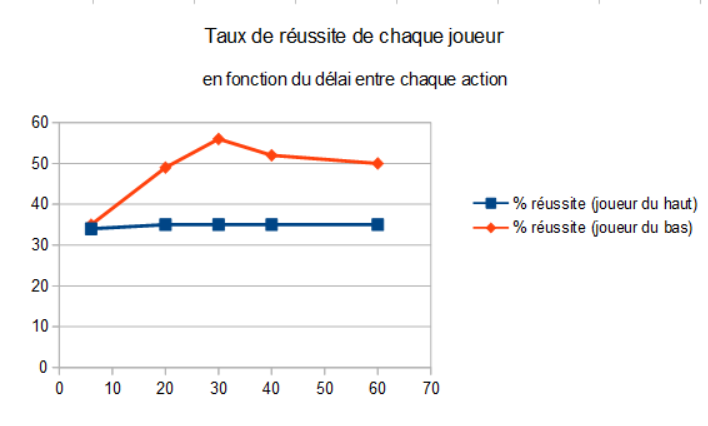
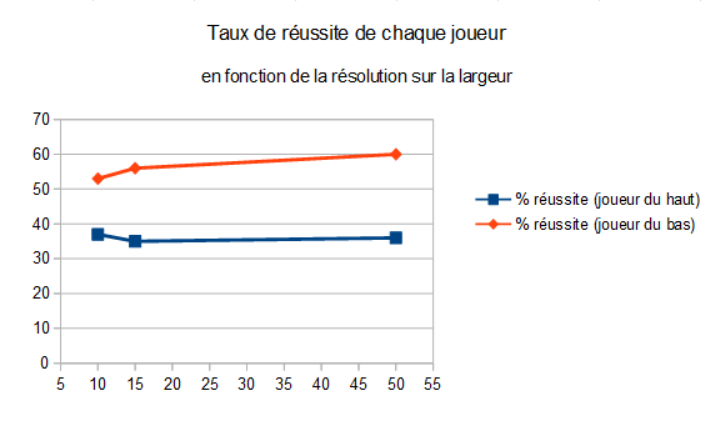

# Atari Tennis — Q-learning multi-agents

**Projet d’initiation à la recherche · Master 1 Web & Science des Données · ULCO · 2025–2026**

J’ai mené cette étude en binôme avec **Jean-Baptiste Ragues**, afin d’examiner l’apprentissage de deux joueurs dans l’environnement Atari Tennis. Nous avons étudié la chaîne qui transforme les images du jeu en positions d’objets, états discrets, actions et récompenses pour le Q-learning tabulaire.

**Python · PettingZoo · OpenCV · Q-learning · Apprentissage par renforcement · Analyse expérimentale**

[Rapport final en anglais](docs/rapport.pdf) · [Énoncé du sujet](docs/enonce.pdf) · [Consignes du module](docs/consignes.pdf)

Ce dépôt présente le rapport, les documents pédagogiques et les figures des expériences. Les descriptions et observations ci-dessous proviennent du rapport final.

## Objectif de l’étude

Atari Tennis oppose deux joueurs qui doivent se positionner pour renvoyer la balle. Les observations sont des images, tandis qu’un algorithme tabulaire a besoin d’un nombre limité d’états. La difficulté est donc de construire une représentation fiable du jeu, puis un signal de récompense qui permet d’évaluer les décisions des joueurs.

La chaîne étudiée comprend la détection des joueurs et de la balle, la discrétisation de leurs positions, le choix d’une action, le calcul de la récompense et la mise à jour des tables Q. Les essais simplifiés utilisent trois actions horizontales : rester sur place, aller à gauche et aller à droite.

## Approches comparées

### Détection visuelle

Deux méthodes sont étudiées : la différence entre images successives, avec des seuils de couleur, et la détection de contours et de centres avec OpenCV. La seconde permet aussi de mesurer les dimensions des sprites. La fiabilité de la détection conditionne les états et les récompenses transmis aux agents.

| Différence entre images successives | Détection de contours |
| --- | --- |
|  |  |

### Représentation des états

| Représentation | Information conservée | Nombre d’états |
| --- | --- | --- |
| Globale | Position relative de la balle par rapport aux deux joueurs | 81 |
| Individuelle | Neuf régions autour de chaque joueur | 9 par joueur |
| Individuelle simplifiée | Balle à gauche, alignée ou à droite du joueur | 3 par joueur |

La représentation à trois états sert notamment à vérifier les récompenses avec une politique de référence : aller vers la balle lorsqu’elle est à gauche ou à droite, et rester sur place lorsqu’elle est alignée. Les valeurs d’une table Q initialement vide sont mises à jour pendant ce contrôle.

### Récompenses

L’étude examine le score natif du jeu et trois indices intermédiaires : les changements de direction de la balle, sa proximité avec un joueur et les variations de largeur du sprite. Ces indices sont analysés séparément ; le rapport ne fournit pas de coefficients validés pour une récompense combinée.

## Expériences et observations

Le protocole préliminaire décrit **1 000 épisodes**, avec un taux d’apprentissage de **0,05**, un facteur d’actualisation de **0,95**, une exploration initiale de **0,9** et une décroissance de **0,9999**. Les joueurs conservent leur côté du terrain pendant ces essais.

| Expérience | Configurations étudiées | Observation rapportée |
| --- | --- | --- |
| Résolution de la grille | 5 × 10, 10 × 10, 20 × 20, 20 × 30, 30 × 30, 20 × 50 | La grille 20 × 30 obtient les meilleurs indicateurs dans cette comparaison préliminaire |
| Délai entre décisions | 5, 20, 30, 40 et 60 images | Le joueur du bas s’améliore jusqu’à environ 30 images, puis ses résultats diminuent légèrement |
| Résolution horizontale | 10, 15 et 50 cellules | Une résolution plus fine améliore les indicateurs du joueur du bas ; ceux du joueur du haut restent plus stables |

Les indicateurs portent sur la durée des échanges et la proportion d’actions cohérentes avec le comportement simplifié attendu. Une asymétrie entre les deux côtés du terrain apparaît dans les résultats.

Les résultats constituent des diagnostics de la chaîne perception–décision. Le rapport ne démontre pas encore une courbe d’apprentissage compétitif stable et ne documente pas de répétitions avec plusieurs graines aléatoires. Une évaluation complète devra mesurer l’évolution des retours par épisode et des scores, avec plusieurs exécutions indépendantes.

## Ce que ce projet m’a apporté

- Relier la perception visuelle d’un environnement à une représentation d’état exploitable.
- Étudier le Q-learning tabulaire dans un jeu à deux compétiteurs.
- Comparer des représentations d’états et des signaux de récompense.
- Concevoir des expériences de sensibilité et interpréter leurs limites.
- Présenter un travail de recherche en anglais sous forme d’article.

## Documents et figures

| Chemin | Contenu |
| --- | --- |
| `docs/rapport.pdf` | Rapport final : *Multi-Agent Q-Learning for Competitive Atari Tennis* |
| `docs/enonce.pdf` | Sujet n°9, extrait de la page 14 du document pédagogique |
| `docs/consignes.pdf` | Cadre du module et structure attendue de l’article : pages 1 à 5, 18 et 19 |
| `assets/` | Figures originales extraites du rapport, avec leur provenance documentée |

## Auteurs et cadre universitaire

**Abdelmoughit Douimia et Jean-Baptiste Ragues** — Université du Littoral Côte d’Opale.

Projet réalisé dans le cadre du module d’initiation à la recherche de M1 WeDSci/I2L. Les consignes du module mentionnent Gaston Batchoudi, Eric Ramat et Sara Tari comme encadrants. Le rapport conserve ses deux auteurs et sa bibliographie.
